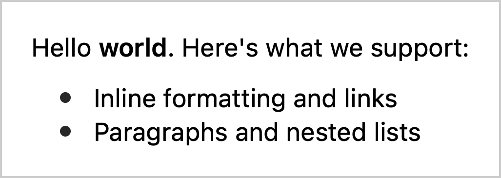
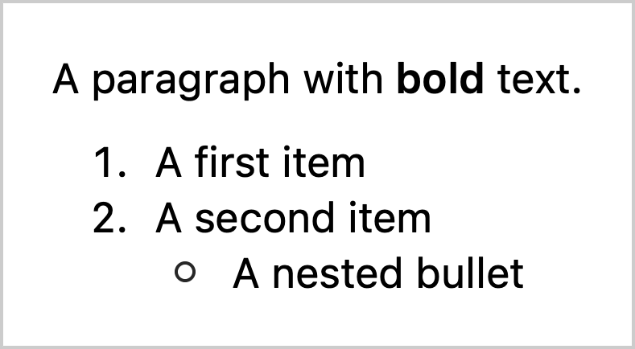

# SimpleHTML

Parse HTML into attributed strings and render them in SwiftUI, with as much control over the process as your app needs.

```swift
import SimpleHTML
import SwiftUI

HTMLView(html: """
    <p>Hello <strong>world</strong>. Here's what we support:</p>
    <ul><li>Inline formatting and links</li><li>Paragraphs and nested lists</li></ul>
    """)
    .font(.body)
    .tint(.purple)
```



SimpleHTML uses libxml2 to parse HTML tags, builds Foundation presentation intents from them, and lets SwiftUI handle the text. Each layer is useful on its own: start with a view, work with attributed strings, or take over parsing to build something specific to your app.

## Installation

Add [SimpleHTML](https://github.com/davbeck/SimpleHTML) in Xcode's **File > Add Package Dependencies…**, then link the `SimpleHTML` product to your target.

The package requires Swift 6.2 or newer and supports iOS 15 and macOS 12 or newer. libxml2 is provided by the system; there is no separate runtime to install.

## Usage

### Display HTML

`HTMLView` is the simplest interface. It parses HTML and uses `BlockTextView` to lay out paragraphs and lists. Apply normal SwiftUI modifiers to choose the font, link tint, spacing, and alignment.

```swift
HTMLView(html: "<p>A little <em>emphasis</em>.</p><p>A longer paragraph makes the centered alignment clear.</p>")
    .font(.title3)
    .multilineTextAlignment(.center)
```


See the [HTMLView documentation](Sources/SimpleHTML/HTMLView.swift).

### Display other attributed text

`BlockTextView` accepts any attributed string that uses Foundation's presentation intents, including one created from Markdown. Parsing and rendering do not have to come from the same place.

```swift
let text = try AttributedString(markdown: """
    A paragraph with **bold** text.

    1. A first item
    2. A second item
       - A nested bullet
    """)

BlockTextView(attributedString: text)
```



See the [BlockTextView documentation](Sources/SimpleHTML/BlockTextView.swift) for layout behavior and the kinds of blocks it supports.

### Work with attributed strings

If you do not need a view, use `AttributedString(html:)` or `HTMLAttributedStringBuilder` directly. The result includes inline formatting, block presentation intents, and the original element's name, attributes, and ancestry on each run.

```swift
let builder = HTMLAttributedStringBuilder(
    html: "<p>Save <strong>this</strong> for later.</p>"
)
let text = builder.generatedAttributedString()
```

That metadata lets your app recognize its own CSS classes, choose how to display images, or produce plain text. See the [builder documentation](Sources/SimpleHTML/HTMLAttributedStringBuilder.swift) and [customization examples](Sources/SimpleHTML/SimpleHTML.docc/CustomizingHTML.md).

### Build your own representation

`HTMLParser` provides synchronous delegate callbacks for elements, text, and other HTML events. Use it when you want different tag handling or a different output entirely, such as building a Core Text attributed string directly without an intermediate Swift `AttributedString`.

See the [HTMLParser documentation](Sources/SimpleHTML/HTMLParser.swift) and [custom parser examples](Sources/SimpleHTML/SimpleHTML.docc/CustomParsing.md).

## Why not Foundation's HTML importer?

`NSAttributedString` can import HTML, but its HTML importer has had reliability problems since its introduction on iOS 7. In [a 2019 Apple Developer Forums response](https://forums.developer.apple.com/forums/thread/115405?answerId=356326022#356326022), an Apple engineer recommended avoiding the API. SimpleHTML grew out of working with HTML in several iOS apps: parsing tags with libxml2 and explicitly building attributed strings has been a much more reliable approach for the HTML those apps expect.

It is also fast. In a measurement on an iPhone 13 Pro, Foundation's importer took about **6 ms** to parse a small HTML string, while this implementation took **0.04 ms**—roughly two orders of magnitude faster. These are observations from that workload, not a benchmark guarantee for every document or device.

| | SimpleHTML | Foundation HTML import |
| --- | --- | --- |
| Output | Swift `AttributedString` with presentation intents and HTML element metadata | `NSAttributedString` with imported formatting |
| Styling | Selected tags and app-defined interpretation of element attributes | Broader HTML and CSS interpretation |
| Rendering | SwiftUI paragraphs and lists, or your own renderer | Your app's attributed-text renderer |
| Customization | Post-process runs or supply a parser delegate | Import options and post-processing |

The tradeoff is scope. SimpleHTML does **not** implement a CSS engine or browser layout. It is best suited to HTML whose structure you know upfront, such as content from a particular service. If your app expects a class like `invisible`, `ellipsis`, or `warning`, you can recognize that class and implement its meaning explicitly. [Customizing HTML](Sources/SimpleHTML/SimpleHTML.docc/CustomizingHTML.md) shows this approach.

The default builder maps HTML tags to bold (`strong`, `b`), italic (`em`, `i`), underline (`u`), links (`a`), paragraphs (`p`), lists (`ul`, `ol`, `li`), and line breaks (`br`). Images and iframes retain metadata for custom rendering; the built-in views do not load or display that media. See [Displaying images and YouTube embeds](Sources/SimpleHTML/SimpleHTML.docc/EmbeddedMedia.md) for a custom SwiftUI renderer. Use a web view when you need full web content, CSS layout, or JavaScript.

## Documentation

The package includes a [DocC catalog](Sources/SimpleHTML/SimpleHTML.docc/SimpleHTML.md) with component references and examples. In Xcode, use **Product > Build Documentation** to browse it alongside the API.

## Contributing

Bug reports, documentation improvements, and pull requests are welcome. See [CONTRIBUTING.md](CONTRIBUTING.md) for development and testing instructions. By participating, you agree to the [Code of Conduct](CODE_OF_CONDUCT.md).

## Acknowledgments

SimpleHTML's HTML parsing approach was originally based on [DTCoreText](https://github.com/Cocoanetics/DTCoreText) and its DTFoundation parser.
